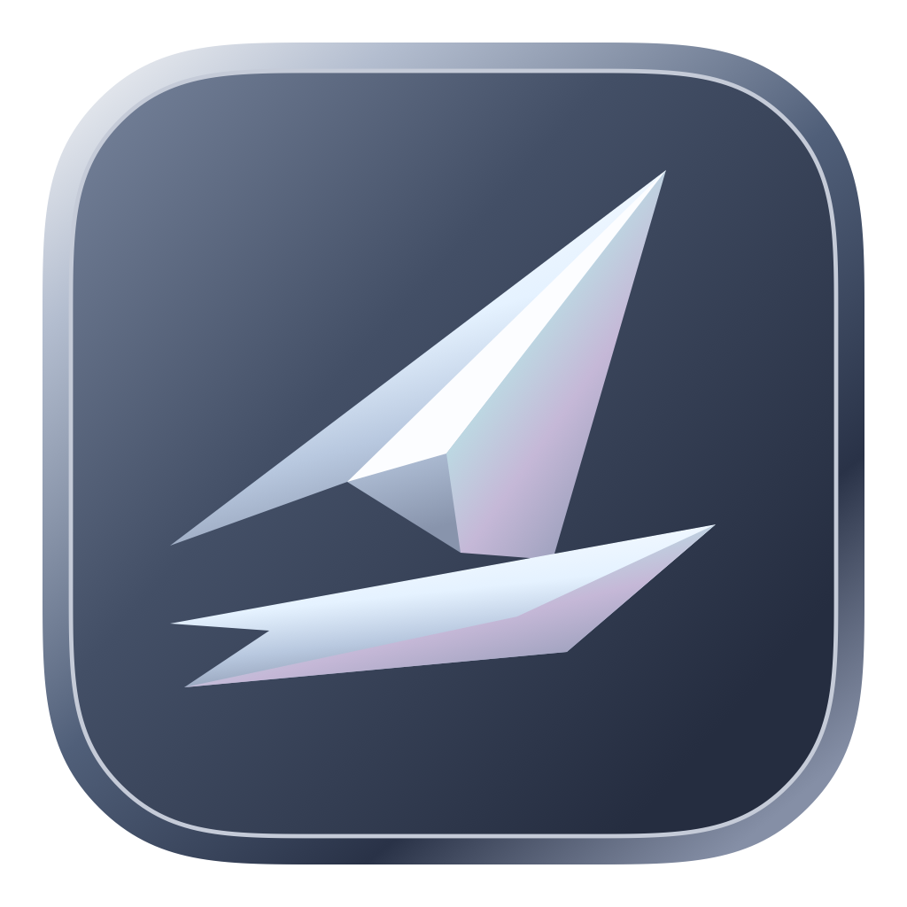

<p align="center">
  
</p>

<h1 align="center">Skiff</h1>

<p align="center">MyGo で構築したデスクトップ向けダウンロードマネージャーです。Go のネイティブ UI と GPU レンダリングを使用し、ファイルへの直接リンク、マグネットリンク、トレントファイルに対応しています。</p>

<p align="center">
  <a href="README.md">English</a> · <a href="README.zh-CN.md">简体中文</a> · <a href="README.zh-Hant.md">繁體中文</a> · <strong>日本語</strong>
</p>

<p align="center">
  <a href="https://github.com/chen-985211/skiff/releases/latest"></a>
  <a href="https://github.com/chen-985211/skiff/releases"></a>
  <a href="https://github.com/aria2/aria2"></a>
  <a href="LICENSE"></a>
</p>

<div align="center">

https://github.com/user-attachments/assets/52e5421b-7dac-4763-a994-52b8a602be83

</div>

## ダウンロード機能

### 通常のファイル

- **リンクの追加** 「新規ダウンロード → リンク」で、HTTP、HTTPS、FTP のファイル URL、またはブラウザからコピーした cURL コマンドを貼り付けます。一括追加は 1 行に 1 件、最大 100 件です。有効なリンクがキューに入ります。重複はスキップされ、無効な行と上限を超えた行は入力欄に残ります。
- **保存と再開** 既定の保存先や最近使ったフォルダを選択できます。ファイルが 1 件の場合は名前も変更できます。HTTP ダウンロードではリダイレクトをたどり、サーバーが提示するファイル名を使用します。一時停止したダウンロードは、サーバーがバージョン識別子を返さない場合も、中断した位置から再開できます。リモートのファイルが変わった場合やサーバーが再開を拒否した場合は、途中までのファイルを残して別のファイルに最初からダウンロードできます。
- **キューと接続** 同時ダウンロード数は既定で 10 件で、1～200 件に変更できます。待機中のタスクには「優先してダウンロード」を選べます。ファイルのサイズとサーバーの範囲リクエストへの対応状況に応じて、通常は 1～4 接続が選ばれます。「詳細オプション」で上限を 1～16 接続に設定でき、実際の接続数はタスクの詳細で確認できます。
- **速度制限とネットワーク** 「設定 → 全体の速度制限」で全体の帯域幅を制限し、タスクの詳細で個別の上限を指定できます。どちらもプリセットとカスタム値を使用でき、ダウンロード中に反映されます。「プロキシと DNS」では、システムプロキシ、直接接続、認証付き HTTP プロキシ、除外リスト、DNS モードを設定できます。
- **詳細オプション** タスクごとにミラー URL、リクエストヘッダー、プロキシを指定できます。メインの URL が失敗した場合はミラーを順番に試し、内容が一致した場合は進捗を引き継ぎます。「設定 → パフォーマンスとディスク」では、キャッシュ、最小セグメントサイズ、ファイルの事前割り当てを調整できます。

### BitTorrent とマグネットリンク

- **ファイルを選んでダウンロード** 「新規ダウンロード → BT」でローカルの `.torrent` ファイルを開くか、マグネットリンクを貼り付けて「ファイル一覧を読み込む」を選びます。ファイルツリーで必要なファイルを選び、「ダウンロード開始」を押します。マグネットリンクでは、30、60、120 秒後に全ファイルを自動でダウンロードする設定も選べます。選択内容を手動で変更するとカウントダウンが止まります。
- **ピアの管理** 「設定 → BitTorrent ネットワーク」で、トラッカーの購読、DHT、ローカルピア検出、待ち受けポート、ピア数の上限を管理できます。タスクの詳細では、ピア、トラッカー、ピースごとの進捗を確認できます。
- **シードとファイルの再利用** ダウンロード完了後もシードを続け、共有比率や経過時間を条件に停止できます。タスクの詳細では手元の完全なファイルを検証したり、その保存先を指定し直したり、ファイルを移動したりして、シードを再開できます。
- **トレントの作成** 「BT オプション → トレントを作成…」でローカルのファイルまたはフォルダを選び、`.torrent` ファイルを作成します。「元のファイルからシード」を有効にすると、保存後に共有が始まります。

### タスクと操作

- タスクカードには進捗、速度、失敗理由が表示されます。ファイル名を選ぶと取得元とローカルのパスを確認できます。ウインドウ左下のフォルダを選ぶと保存先が開きます。
- タスクは一時停止、再開、再試行できます。状態、名前、リンクで絞り込み、一括で一時停止したり再開したりできます。未完了のダウンロードは再起動後に一時停止状態で復元されます。タスクを削除してもファイルはディスク上に残ります。
- `⌘N` または `Ctrl+N` で新規ダウンロード、`⌘F` または `Ctrl+F` で検索を開きます。起動中に新規ダウンロード画面を閉じてから開き直しても、リンクと保存先の編集を続けられます。
- 速度制限、BT オプション、設定では共通のドロップダウンメニューを使用します。↑ または ↓ で選択候補を移動し、Enter で確定、Esc で閉じます。すばやく逆方向に操作するとハイライトは現在の位置から移動し、システムで視差効果を減らす設定を有効にすると即座に切り替わります。テーマと背景の光沢は「設定 → 外観」で調整できます。
- 表示言語は簡体字中国語、英語、繁体字中国語、日本語に対応しています。「設定 → 外観 → 表示言語」で切り替えるか、システムの言語に合わせることができます。

## はじめに

### macOS で初めて開く

1. Apple シリコン搭載の Mac で [macOS 用の DMG をダウンロード][macos-dmg] して開き、**Skiff.app** を「アプリケーション」フォルダにドラッグします。
2. 「アプリケーション」フォルダから **Skiff** を開きます。このビルドは ad hoc 署名を使用しており、Apple の公証は受けていません。開発元を確認できない旨の警告が表示された場合は、いったん閉じます。
3. 上記の公式リリースから入手したことを確認し、「システム設定 → プライバシーとセキュリティ」で Skiff を探します。「このまま開く」をクリックして確認すると、次回から通常どおり開けます。[Apple の案内](https://support.apple.com/ja-jp/102445)

**ターミナルから初回起動することもできます。** 公式 DMG のアプリを「アプリケーション」フォルダに移動してから以下を実行すると、その Skiff の隔離属性が取り除かれ、アプリが起動します。

```sh
xattr -dr com.apple.quarantine /Applications/Skiff.app && open /Applications/Skiff.app
```

### ダウンロードを始める

Skiff を開き、ウインドウ下部の「新規ダウンロード」を選びます。「エンジンを入手」が表示された場合は、そのボタンを選ぶとシステムとプロセッサに合った aria2c がダウンロードされ、検証されます。aria2c には macOS、Windows、Linux 向けの x64 と ARM64 のビルドがあります。初回のエンジンダウンロードには GitHub への接続が必要です。Windows と macOS ではシステムのプロキシ設定を使用し、Linux では起動時の `HTTPS_PROXY`、`ALL_PROXY`、`NO_PROXY` などの環境変数を読み取ります。[Skiff が使用する aria2c リリース](https://github.com/motrixapp/aria2/releases/tag/v1.37.0-motrix.24)

[macos-dmg]: https://github.com/chen-985211/skiff/releases/latest

## 開発

Go をインストールし、リポジトリのルートで以下を実行します。Go は [go.mod](go.mod) に従ってツールチェーンを選択します。

```sh
go mod download
make dev
```

`make dev` はコードが変わると開発版を再ビルドして起動します。macOS の開発版はローカルの ad hoc 署名を使用します。`go tool mygo dev` を直接実行すると、MyGo がキーチェーンから開発証明書を選びます。Ctrl+C でホットリロードを終了できます。

Skiff は aria2 を別プロセスとして起動します。macOS で結合テストを実行するには、`brew install aria2` でエンジンをインストールするか、既存の aria2c 実行ファイルを `SKIFF_ARIA2_BINARY` で指定します。

## テストとビルド

```sh
make test                 # 単体テストとアーキテクチャの契約テスト
make test-integration     # 実際の aria2、ローカル HTTP、RPC、ファイル保存
make check-ui             # UI の契約、操作、アニメーションの回帰テスト
make check                # 書式、vet、競合検出を含む全テスト、ビルド
make package              # 現在のプラットフォーム向けのネイティブパッケージ
```

macOS アプリの出力先は `build/darwin-arm64/Skiff.app` です。MyGo が macOS でローカルに作成するパッケージは ad hoc 署名を使用します。

`mygo.json` のバージョンに一致し、`v` で始まる Git タグをプッシュするとリリースが開始されます。3 つのプラットフォームでテストとパッケージ作成が成功すると、[GitHub Releases](https://github.com/chen-985211/skiff/releases) に Apple シリコン搭載 Mac 用の DMG、Windows x64 用の EXE、Linux x64 用の DEB、RPM、tar.gz が公開されます。

## ライセンス

Skiff は [MIT ライセンス](LICENSE)で提供されています。
