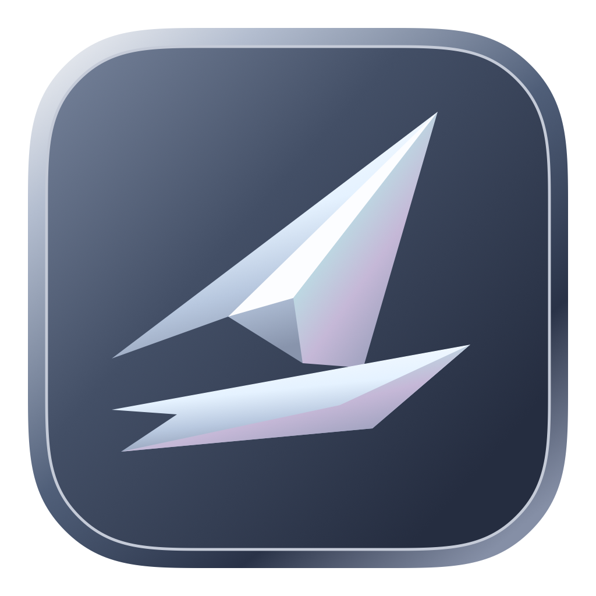

<p align="center">
  
</p>

<h1 align="center">Skiff</h1>

<p align="center">以 MyGo 打造的桌面下載工具，使用 Go 原生使用者介面與 GPU 算繪，支援檔案直連網址、磁力連結與種子檔案。</p>

<p align="center">
  <a href="README.md">English</a> · <a href="README.zh-CN.md">简体中文</a> · <strong>繁體中文</strong> · <a href="README.ja.md">日本語</a>
</p>

<p align="center">
  <a href="https://github.com/chen-985211/skiff/releases/latest"></a>
  <a href="https://github.com/chen-985211/skiff/releases"></a>
  <a href="https://github.com/aria2/aria2"></a>
  <a href="LICENSE"></a>
</p>

<div align="center">

https://github.com/user-attachments/assets/52e5421b-7dac-4763-a994-52b8a602be83

</div>

## 下載功能

### 一般檔案

- **新增連結**　前往「新增下載 → 連結」，貼上 HTTP、HTTPS、FTP 檔案網址或從瀏覽器複製的 cURL 指令。批次新增時每行一個連結，每批最多 100 個。有效連結會加入佇列，重複的連結會略過，無效或超過上限的行會留在輸入框內。
- **儲存與續傳**　可使用預設資料夾、選擇最近使用的資料夾，或重新命名單一檔案。HTTP 下載會跟隨重新導向，並識別伺服器提供的檔名。暫停後會從中斷點繼續，伺服器未提供版本識別資訊時會使用原有的續傳紀錄。遠端檔案變更或伺服器拒絕續傳時，可另存新檔重新下載，保留已下載的部分。
- **佇列與連線**　預設同時下載 10 項，可調整至 1～200 項。佇列已滿時，可將等候中的任務設為「優先下載」。單一檔案會依大小和伺服器的分段下載能力，自動選擇 1～4 條連線。可在「進階選項」將上限設為 1～16 條，實際連線數可在任務詳情中查看。
- **速限與網路**　可在「設定 → 全域速限」限制總頻寬，或在任務詳情中個別限速。兩者都支援預設值和自訂數值，可在下載期間立即生效。「代理與 DNS」可設定系統代理、直接連線、需驗證的 HTTP 代理、略過清單和 DNS 模式。
- **進階選項**　可為個別任務設定備用網址、HTTP 請求標頭或代理。主要網址失敗時會依序嘗試備用網址，確認內容相符後可沿用下載進度。「設定 → 性能與磁碟」可調整快取、最小分段大小和檔案預先配置。

### BitTorrent 與磁力連結

- **選擇下載的檔案**　前往「新增下載 → BT」，開啟本機的 `.torrent` 檔案，或貼上磁力連結後點選「讀取檔案清單」。在檔案樹中勾選需要的檔案，再點選「開始下載」。也可設定磁力任務在 30、60 或 120 秒後自動下載全部檔案。手動變更勾選項目會取消倒數。
- **管理節點**　在「設定 → BT 網路」管理 Tracker 訂閱、DHT、區域網路節點探索、監聽連接埠和節點上限。任務詳情可查看節點、Tracker 和分片進度。
- **做種與重複使用檔案**　下載完成後可繼續做種，並依分享率或時間上限停止。可在任務詳情中驗證、重新定位或移動已有的完整檔案，再恢復做種。
- **建立種子**　在「BT 選項 → 建立種子…」選擇本機的檔案或資料夾，產生 `.torrent` 檔案。勾選「用原始檔案做種」後，儲存時便會開始分享。

### 任務與操作

- 任務卡片顯示進度、速度和失敗原因。點按檔名可查看來源和本機路徑，點按左下角的資料夾可開啟儲存資料夾。
- 可暫停、繼續或重試任務，也可依狀態、名稱或連結篩選後批次暫停、繼續。重新啟動後，未完成的下載會以暫停狀態復原。移除任務會保留磁碟上的檔案。
- 按 `⌘N` 或 `Ctrl+N` 新增下載，按 `⌘F` 或 `Ctrl+F` 搜尋。在同一次執行期間重新開啟新增下載面板，可以繼續編輯連結和儲存資料夾。
- 速限、BT 選項和設定共用下拉式選單。按 ↑ 或 ↓ 移動反白項目、Enter 確認、Esc 關閉。快速反向操作時，反白會從當前位置繼續移動。啟用系統的「減少動態效果」後，反白會直接切換。可在「設定 → 外觀」調整主題和背景流光。
- 介面支援簡體中文、英文、繁體中文和日語。可在「設定 → 外觀 → 介面語言」切換，也可跟隨系統語言。

## 初次使用

### macOS 初次開啟

1. 在搭載 Apple 晶片的 Mac 上，[下載 macOS 安裝套件（DMG）][macos-dmg]，開啟後將 **Skiff.app** 拖曳到「應用程式」。
2. 在「應用程式」中按兩下 **Skiff**。此版本使用 ad hoc 簽名，尚未經過 Apple 驗證。如果 macOS 顯示無法驗證開發者的提示，請先關閉提示。
3. 確認 App 來自上方的官方發行頁面後，開啟「系統設定 → 隱私權與安全性」，找到 Skiff，點選「強制打開」並確認。之後即可按兩下開啟。[Apple 支援](https://support.apple.com/zh-tw/102445)

**也可使用終端機完成初次開啟。** 將官方 DMG 中的 App 拖曳到「應用程式」後，執行下面的指令。指令會移除這份 Skiff 的下載隔離屬性，然後啟動 App。

```sh
xattr -dr com.apple.quarantine /Applications/Skiff.app && open /Applications/Skiff.app
```

### 開始下載

開啟 Skiff 並點選視窗底部的「新增下載」。如果看到「下載引擎」，點選後 Skiff 會下載並驗證符合系統和處理器架構的 aria2c。完成後即可新增下載。aria2c 為 macOS、Windows 和 Linux 提供 x64 和 ARM64 版本，初次下載引擎時需連線至 GitHub。Windows 和 macOS 會讀取系統代理設定。Linux 會讀取啟動時的代理環境變數，例如 `HTTPS_PROXY`、`ALL_PROXY` 和 `NO_PROXY`。[Skiff 使用的 aria2c 發行套件](https://github.com/motrixapp/aria2/releases/tag/v1.37.0-motrix.24)

[macos-dmg]: https://github.com/chen-985211/skiff/releases/latest

## 開發

安裝 Go 後，在儲存庫根目錄執行以下指令。Go 會依照 [go.mod](go.mod) 選用工具鏈。

```sh
go mod download
make dev
```

`make dev` 會在程式碼變更後重新建置並啟動開發版。macOS 開發版使用本機 ad hoc 簽名。直接執行 `go tool mygo dev` 時，MyGo 會從鑰匙圈選擇開發憑證。按 Ctrl+C 停止熱重載。

Skiff 會將 aria2 作為獨立程序啟動。在 macOS 執行整合測試時，可使用 `brew install aria2` 安裝測試引擎，或將 `SKIFF_ARIA2_BINARY` 指向已有的 aria2c 執行檔。

## 驗證與建置

```sh
make test                 # 單元測試與架構契約
make test-integration     # 真實 aria2、本機 HTTP、RPC 與檔案儲存
make check-ui             # 介面契約、互動與動畫回歸測試
make check                # 格式、vet、完整測試含競態偵測，以及編譯
make package              # 目前平台的原生套件
```

macOS App 會放在 `build/darwin-arm64/Skiff.app`。MyGo 在 macOS 的本機套件使用 ad hoc 簽名。

推送以 `v` 開頭且符合 `mygo.json` 版本的 Git 標籤，即可觸發發行流程。三個平台的測試與打包都通過後，[GitHub Releases](https://github.com/chen-985211/skiff/releases) 會提供 Apple 晶片 Mac 的 DMG、Windows x64 的 EXE，以及 Linux x64 的 DEB、RPM 和 tar.gz。

## 授權條款

Skiff 採用 [MIT 授權條款](LICENSE)。
